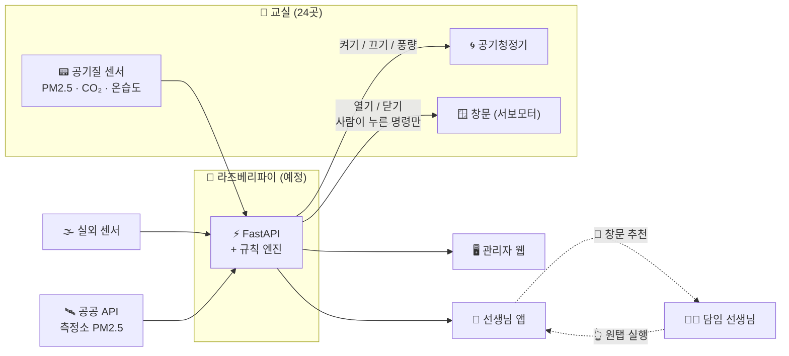
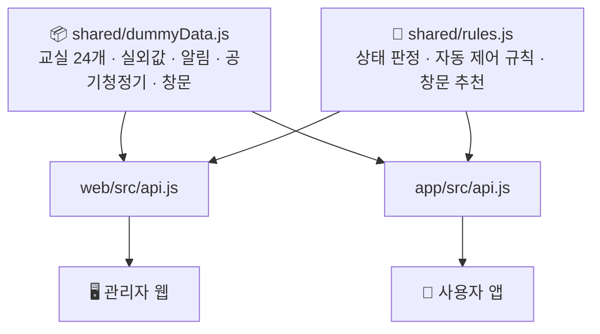
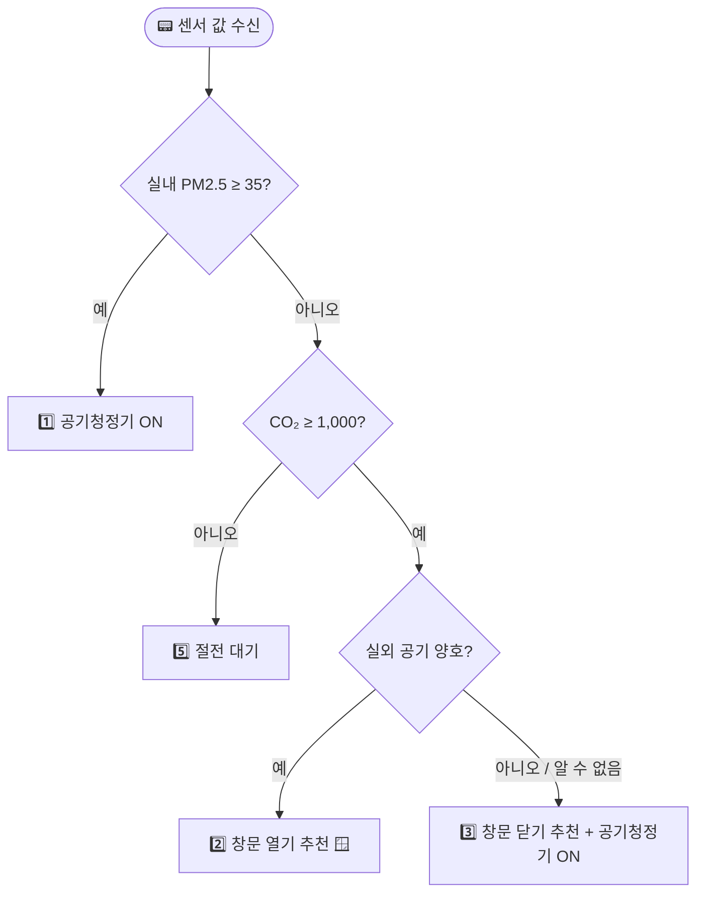
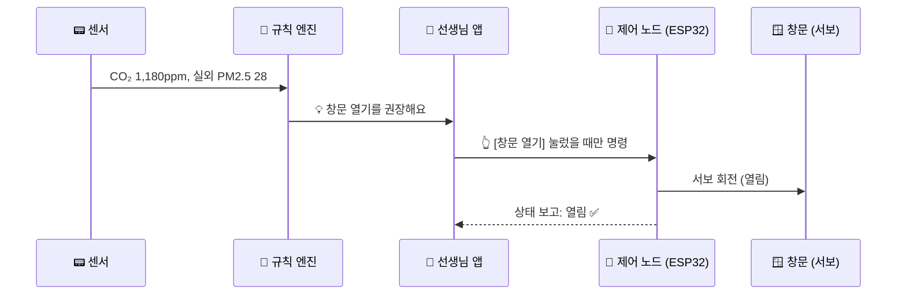
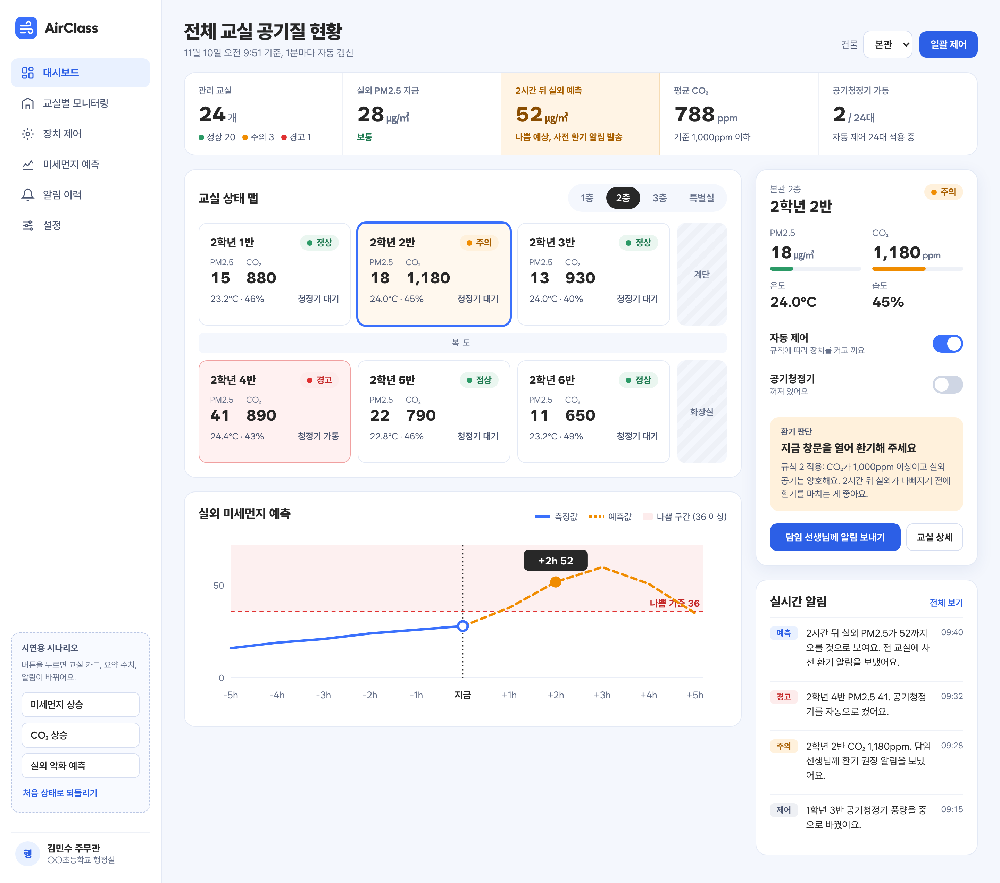
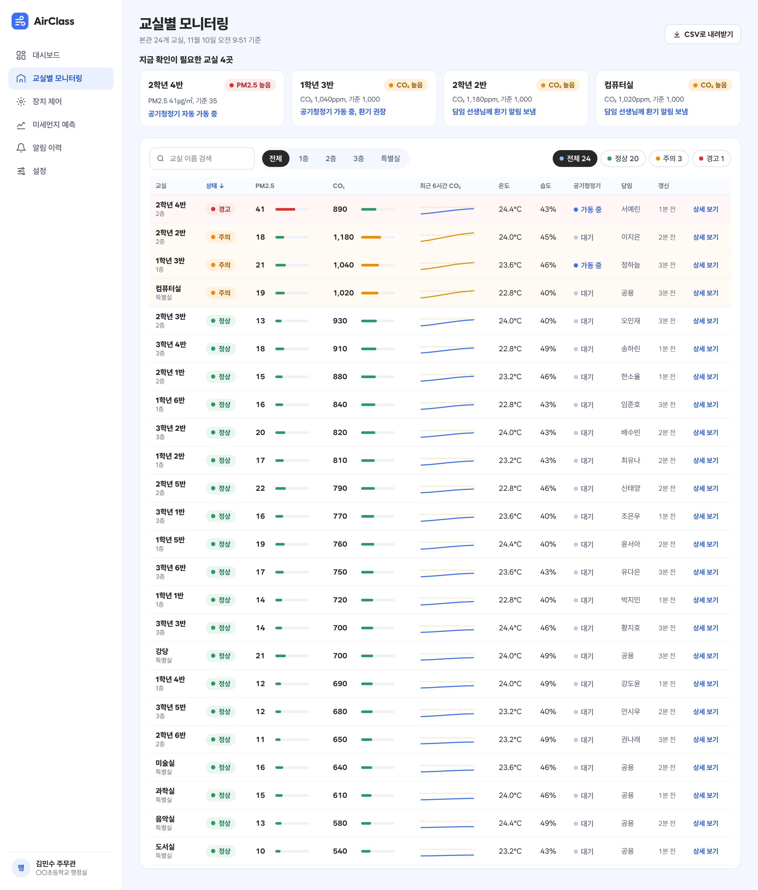
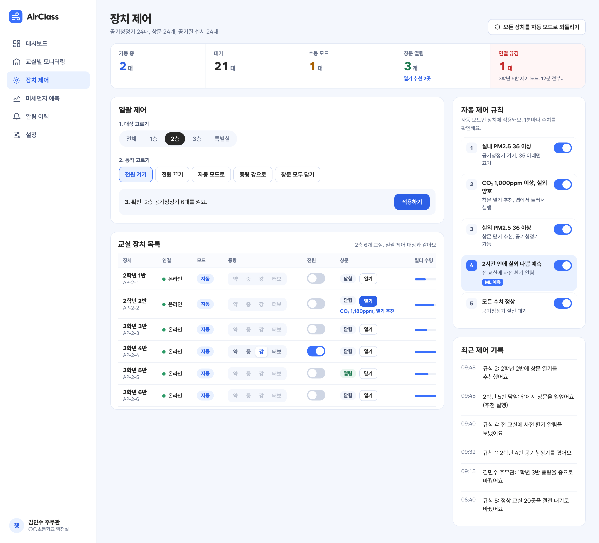
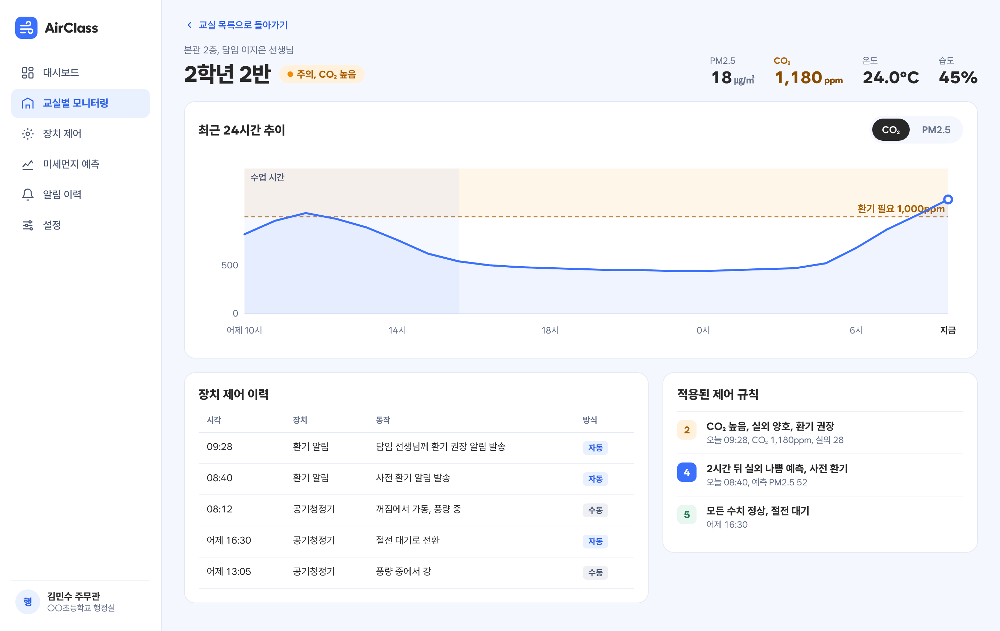
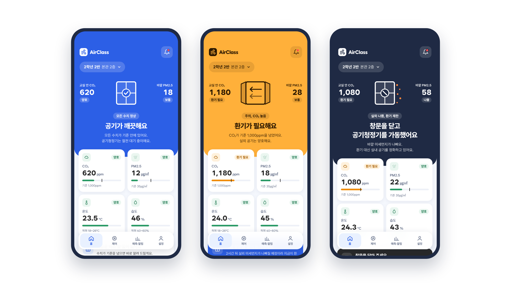
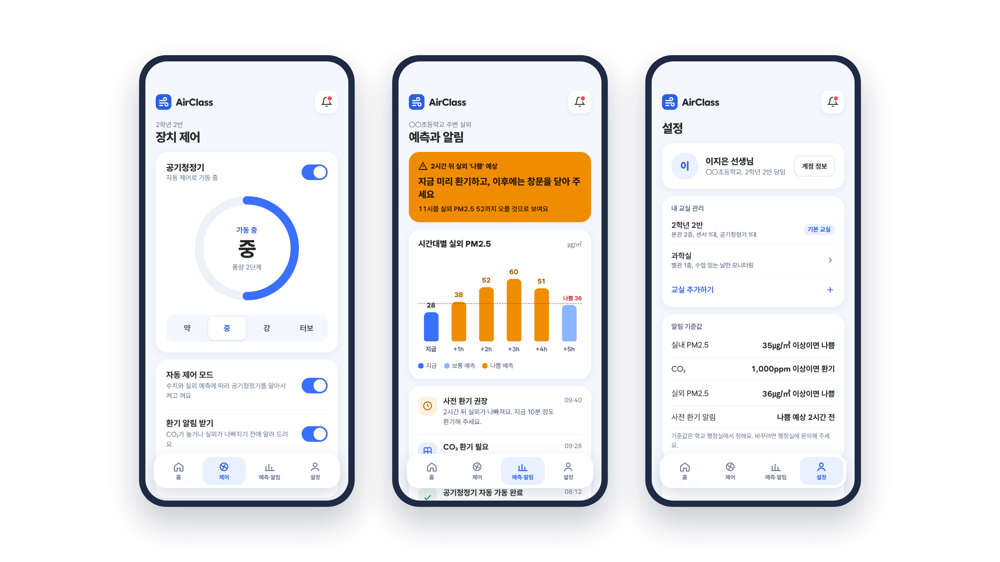

# 🌬️ AirClass — 스마트 교실 공기질 관리 시스템

> 교실 안 공기(PM2.5 · CO₂ · 온습도)와 바깥 미세먼지를 함께 보고,
> **공기청정기를 자동으로 제어**하고, **창문 열기·닫기를 추천**해 선생님이 **버튼 한 번으로 실행**하게 하는 IoT 시스템이에요. 🏫


> [!NOTE]
> 지금은 **UI 프로토타입** 단계예요. 모든 수치는 `shared/dummyData.js`의 더미 데이터이고,
> 이후 라즈베리파이의 **FastAPI 백엔드**로 교체할 예정이에요.

---

## 📌 목차

- [왜 만들었나요?](#-왜-만들었나요)
- [주요 기능](#-주요-기능)
- [시스템 구성](#-시스템-구성)
- [상태 판정과 자동 제어 규칙](#-상태-판정과-자동-제어-규칙)
- [창문 반자동 제어](#-창문-반자동-제어)
- [화면 미리보기](#-화면-미리보기)
- [기술 스택](#-기술-스택)
- [폴더 구조](#-폴더-구조)
- [실행 방법](#-실행-방법)
- [라즈베리파이 배포](#-라즈베리파이-배포-팀원-공유)
- [시연 방법](#-시연-방법)
- [앞으로 할 일](#-앞으로-할-일)

---

## 🤔 왜 만들었나요?

교실은 좁은 공간에 많은 학생이 오래 머물러서 **CO₂가 금방 올라가요**. 그렇다고 무작정 창문을 열면
바깥 **미세먼지가 나쁜 날에는 오히려 공기가 더 나빠지죠**. 😷

AirClass는 **실내 값과 실외 값을 함께 판단**해서

- 🪟 바깥 공기가 괜찮으면 → **"창문 열기를 권장해요"** + [창문 열기] 버튼
- 🚫 바깥 공기가 나쁘면 → **"창문 닫기를 권장해요"** + [창문 닫기] 버튼, 공기청정기 가동
- 🌀 실내 미세먼지가 높으면 → **공기청정기 자동 가동**

처럼 상황에 맞는 행동을 안내해요. 창문은 **반자동**으로 제어해요. 시스템은 열기·닫기를 **추천만** 하고,
실제로 여닫는 건 선생님(앱)이나 행정실(웹)이 **버튼을 눌러서** 해요. 학생이 있는 공간이라 창문이 저절로 움직이지 않게 했어요.

---

## ✨ 주요 기능

### 🖥️ 관리자 웹 (행정실 · 1440px 기준, 반응형)

| 화면 | 할 수 있는 일 |
|---|---|
| 📊 **대시보드** | 요약 5개, 층별 교실 상태 맵, 선택 교실 상세 패널, 실외 미세먼지 그래프, 실시간 알림, **시연용 시나리오 버튼** |
| 🔍 **교실별 모니터링** | 확인이 필요한 교실 카드, 검색 · 층 · 상태 필터, 정렬되는 24개 교실 표, 6시간 CO₂ 추이선, **CSV 내려받기** |
| 🎛️ **장치 제어** | 장치 현황(창문 열림 · 추천 수 포함), **일괄 제어 3단계**(대상 → 동작 → 확인, **창문 모두 닫기** 포함), 공기청정기 모드 · 풍량 · 전원, **교실별 창문 상태 · 열기/닫기 · 추천 표시**, 규칙 토글, 제어 기록 |
| 🏷️ **교실 상세** | 24시간 CO₂ / PM2.5 추이(탭 전환), 장치 제어 이력, 적용된 규칙 기록 |

### 📱 사용자 앱 (담임 선생님 · 390×844 기준)

| 화면 | 할 수 있는 일 |
|---|---|
| 🏠 **홈** | 상태에 따라 바뀌는 히어로 색(정상 🔵 / CO₂ 높음 🟠 / 실외 나쁨 🌑), **움직이는 창문 그림**, **창문 카드(상태 + 추천 + 원탭 실행)**, 수치 카드 2×2, 실내·외 비교 |
| 🌀 **제어** | **창문 [열기] [닫기]** + 추천, 공기청정기 전원 · 풍량 4단계, 토글 2개(공기청정기 자동 제어, 창문 추천 알림) |
| 📈 **예측·알림** | 시간대별 실외 PM2.5 막대그래프, 내 교실 알림 목록 |
| ⚙️ **설정** | 내 교실 관리, 알림 기준값, 계정 정보 |

### 🎞️ 요즘 앱 같은 움직임

- 🪟 **창문 애니메이션**: 환기가 필요하면 창문 두 짝이 3D로 **활짝 열리고** 바람이 빠져나가요. 실외가 나쁘면 창이 **닫히고** 먼지가 창에 막혀 튕겨요.
- 🎨 상태가 바뀌면 히어로 배경색이 **부드럽게 섞이며** 바뀌어요.
- 🧭 떠 있는 둥근 탭바에서 선택 배경이 **미끄러지듯** 따라가요.
- 🚀 바람 선이 그려지는 **스플래시 화면**으로 앱이 시작돼요.
- ♿ iOS · OS의 **'동작 줄이기'** 설정을 켜면 애니메이션 없이 바로 보여 줘요.

---

## 🧩 시스템 구성



지금 프로토타입에서는 FastAPI 대신 **`shared/` 폴더**가 데이터와 규칙을 맡아요.
웹과 앱은 각각 `web/src/api.js`, `app/src/api.js` **한 파일만 거쳐** 데이터를 가져오기 때문에,
나중에 이 파일만 바꾸면 실제 백엔드로 교체할 수 있어요. 🔌



---

## 🧠 상태 판정과 자동 제어 규칙

### 🚦 상태 판정 기준

| 조건 | 판정 |
|---|---|
| 실내 PM2.5 ≥ **35** ㎍/㎥ | 🔴 **경고** (나쁨) |
| 실내 CO₂ ≥ **1,000** ppm | 🟠 **주의** (환기 필요) |
| 실외 PM2.5 ≥ **36** ㎍/㎥ | 🌫️ **실외 나쁨** |
| 둘 다 해당 | 🔴 경고가 우선 |

### ⚙️ 자동 제어 규칙

| 규칙 | 조건 | 동작 |
|:---:|---|---|
| 1️⃣ | 실내 PM2.5 ≥ 35 | 🌀 공기청정기 ON (35 미만이면 OFF) |
| 2️⃣ | CO₂ ≥ 1,000 + 실외 양호 | 🪟 **창문 열기 추천** (앱에서 눌러서 실행) |
| 3️⃣ | CO₂ ≥ 1,000 + 실외 나쁨 | 🚫 **창문 닫기 추천** + 공기청정기 가동 |
| 4️⃣ | 2시간 안에 실외 나쁨 예측 (ML) | 🔮 사전 환기 알림 — **향후 확장** |
| 5️⃣ | 모두 정상 | 😴 공기청정기 절전 대기 |



> [!TIP]
> - 🖐️ **수동 모드**인 장치는 자동 규칙이 건너뛰어요.
> - 🌫️ 실외값은 **실외 센서가 우선**이에요. 센서 이상, 고습(80% 이상), 데이터 없음일 때는 **공공 API 값**으로 대신해요.
> - ❓ 실외 상태를 알 수 없으면 안전하게 **"나쁨"으로 간주**해 창문을 닫아 두도록 안내해요.

---

## 🪟 창문 반자동 제어

창문은 **시스템이 추천하고, 사람이 버튼으로 실행**해요.
추천 로직은 `shared/rules.js`의 `recommendWindow()` 한 곳에 있고, 웹과 앱이 같은 함수를 써요.

| 상황 | 추천 | 화면 |
|---|---|---|
| 🌫️ 실외 나쁨(또는 알 수 없음) + 창문 **열림** | 🚫 **닫기 추천** | 앱: 흰 카드 + [창문 닫기] / 웹: "창문 닫기를 권장해요" |
| 💨 CO₂ ≥ 1,000 + 실외 양호 + 실내 PM2.5 정상 + 창문 **닫힘** | 🪟 **열기 추천** | 앱: 파란 카드 + [창문 열기] / 웹: 파란 [열기] 버튼 |
| 그 밖의 경우 | 추천 없음 | 필요하면 직접 여닫기 가능 |
| 🔌 제어 노드 연결 끊김 | 추천 없음 | 버튼 비활성, 상태 "알 수 없음" |



> [!NOTE]
> **왜 완전 자동이 아닌가요?** 학생이 있는 교실에서 창문이 저절로 닫히면 손 끼임 위험이 있어요.
> 그래서 시스템은 판단과 추천까지만 하고, 실행은 사람이 승인하는 **반자동** 방식을 택했어요.
> 시연은 **서보모터로 여닫는 축소 모형**으로 해요. 완전 자동은 설정 하나로 확장할 수 있게 구조를 열어 두었어요.

---

## 🖼️ 화면 미리보기

> 아래 이미지는 화면을 만들 때 기준으로 삼은 **디자인 시안**(`docs/`)이에요.

### 🖥️ 관리자 웹

<table>
  <tr>
    <td align="center"><b>📊 대시보드</b><br/></td>
    <td align="center"><b>🔍 교실별 모니터링</b><br/></td>
  </tr>
  <tr>
    <td align="center"><b>🎛️ 장치 제어</b><br/></td>
    <td align="center"><b>🏷️ 교실 상세</b><br/></td>
  </tr>
</table>

### 📱 사용자 앱 — 홈 3가지 상태

<p align="center">
  
</p>

| 🔵 정상 | 🟠 CO₂ 높음 | 🌑 실외 나쁨 |
|---|---|---|
| 창문 닫힘 + ✅ 체크 | 창문 **열림** + 바람 ➡️ | 창문 **닫힘** + 🚫 + 먼지 |
| "공기가 깨끗해요" | "환기가 필요해요" | "창문을 닫고 실내 공기를 정화할게요" |
| 창문 카드: 추천 없음 | 💡 **창문 열기 추천** + [창문 열기] | 💡 **창문 닫기 추천** + [창문 닫기] |

### 📱 사용자 앱 — 제어 · 예측·알림 · 설정

<p align="center">
  
</p>

---

## 🛠️ 기술 스택

| 영역 | 스택 |
|---|---|
| 🖥️ 관리자 웹 | React 19 + Vite, react-router-dom, recharts, lucide-react |
| 📱 사용자 앱 | Expo SDK 58 (React Native), expo-router, react-native-svg, lucide-react-native, expo-splash-screen |
| 🧠 공용 로직 | 순수 JavaScript 모듈 (`shared/`) — 웹 · 앱이 같은 규칙을 사용 |
| 🔤 폰트 | [Wanted Sans](https://github.com/wanteddev/wanted-sans) (SIL OFL 1.1) |
| 🎞️ 애니메이션 | 웹: CSS 트랜지션 · 키프레임 / 앱: React Native `Animated` (추가 라이브러리 없음) |

### 🎨 디자인 토큰

| 이름 | 색 | 용도 |
|---|---|---|
| primary |  `#3a70fc` | 브랜드 색, 아이콘, 그래프 |
| primaryDeep |  `#2c5fe6` | 버튼 배경 |
| primarySoft |  `#e9f1ff` | 선택 상태, 강조 배경 |
| ok |  `#2b9a66` | 🟢 정상 |
| warn |  `#f08c00` | 🟠 주의 (CO₂ 높음) |
| bad |  `#e03131` | 🔴 경고 (PM2.5 높음) |

---

## 📁 폴더 구조

```
airclass/
├── 📄 CLAUDE.md            # 프로젝트 규칙 (토큰, 판정 기준, 작업 규칙)
├── 🖼️ docs/                # 디자인 기준 이미지
├── 🧠 shared/              # 웹·앱 공용 코드
│   ├── dummyData.js       #   더미 데이터 (교실 24개, 실외값, 알림, 공기청정기 · 창문, 제어 기록)
│   └── rules.js           #   상태 판정 + 자동 제어 규칙 + 창문 추천 (recommendWindow)
├── 🍓 deploy/              # 라즈베리파이 배포 (Dockerfile, nginx.conf)
├── 🐳 docker-compose.yml   # docker compose up -d --build
├── 🖥️ web/                 # 관리자 웹 (React + Vite)
│   └── src/
│       ├── api.js         #   데이터 접근 창구 (→ 나중에 FastAPI)
│       ├── Layout.jsx     #   사이드바 + 시연 시나리오
│       ├── ui.jsx         #   공용 컴포넌트 (카드, 배지, 스위치 …)
│       └── pages/         #   Dashboard · Monitoring · Devices · RoomDetail
└── 📱 app/                 # 사용자 앱 (Expo / React Native)
    └── src/
        ├── api.js         #   데이터 접근 창구 (→ 나중에 FastAPI)
        ├── motion.jsx     #   공용 모션 (FadeIn, PressScale, SlidingPill …)
        ├── WindowArt.jsx  #   상태별로 움직이는 창문 그림
        ├── WindowCard.jsx #   창문 카드 (상태 + 추천 + 원탭 실행)
        ├── Splash.jsx     #   시작 애니메이션
        └── app/           #   expo-router 화면 (홈 · 제어 · 예측·알림 · 설정)
```

---

## 🚀 실행 방법

### 🖥️ 관리자 웹

```bash
cd web
npm install
npm run dev        # http://localhost:5173
npm test           # 🧪 시나리오별 자동 제어 결과 확인
```

### 📱 사용자 앱

```bash
cd app
npm install
npx expo login     # 🔐 처음 한 번 (Expo 무료 계정)
npx expo start     # QR 코드를 Expo Go로 스캔
```

### 🌐 사용자 앱 웹 빌드 (휴대폰 브라우저로 보기)

```bash
cd app
npm run build:web  # → app/dist/ (주소 /app/ 기준)
```

같은 앱 코드를 `react-native-web`으로 웹사이트로 만들어요. 결과물을 라즈베리파이 웹 서버의 `/app/`에 올리면
팀원이 설치 없이 휴대폰 브라우저에서 `http://<주소>/app/`으로 볼 수 있어요.

> [!IMPORTANT]
> 실제 iPhone의 **Expo Go**로 열려면 컴퓨터의 Expo CLI와 iPhone의 Expo Go가
> **같은 Expo 계정**으로 로그인돼 있어야 해요. Mac에 Xcode가 있다면 `npx expo start --ios`로
> 시뮬레이터에서 로그인 없이 열 수 있어요.

---

## 🍓 라즈베리파이 배포 (팀원 공유)

관리자 웹(`/`)과 사용자 앱 웹 빌드(`/app/`)를 **nginx 하나로** 띄우고, Tailscale Funnel로 공개 주소를 붙여요.

```bash
# 라즈베리파이에서 (Docker 설치 필요: curl -fsSL https://get.docker.com | sh)
git clone https://github.com/chanyoungjoo/IoT-Term-Project.git airclass
cd airclass
docker compose up -d --build      # 웹·앱 빌드 → nginx로 80번 포트에서 서빙 (첫 빌드는 몇 분 걸려요)
sudo tailscale funnel --bg 80     # https://<라파이름>.<tailnet>.ts.net 공개 주소
```

| 주소 | 화면 |
|---|---|
| `https://<라파이름>.<tailnet>.ts.net/` | 🖥️ 관리자 웹 |
| `https://<라파이름>.<tailnet>.ts.net/app/` | 📱 사용자 앱 (휴대폰 브라우저) |

코드를 바꾼 뒤 다시 배포할 때는 `git pull && docker compose up -d --build`만 하면 돼요.
배포 파일: `docker-compose.yml`, `deploy/Dockerfile`(웹 빌드 → 앱 빌드 → nginx), `deploy/nginx.conf`.

> [!WARNING]
> Funnel 주소는 **링크를 아는 누구나** 접속할 수 있어요. 실제 센서·제어 API를 붙이기 전에 로그인을 추가해야 해요.

---

## 🎬 시연 방법

### 🖥️ 웹 — 사이드바의 **시연용 시나리오** 버튼

| 버튼 | 무엇이 바뀌나요? |
|---|---|
| 🌫️ **미세먼지 상승** | 2학년 5반 PM2.5 47 → 🔴 경고, 공기청정기 자동 가동 (규칙 1) |
| 💨 **CO₂ 상승** | 2학년 1반 · 3반 CO₂ 상승 → 🟠 주의, 환기 권장 알림 (규칙 2) |
| 🌑 **실외 악화** | 실외 PM2.5 41 → CO₂ 높은 교실은 환기 대신 공기청정기 (규칙 3) |
| ↩️ **처음 상태로** | 기본 상태로 되돌려요 |

버튼을 누르면 대시보드 · 모니터링 · 장치 제어 화면의 **숫자, 색, 알림이 함께** 바뀌어요.
**실외 악화**를 누른 뒤 장치 제어 화면을 보면, 창문이 열린 교실(1-1, 2-5, 3-2)에 **닫기 추천**이 떠요.
장치 제어 표에서 [열기]/[닫기]를 누르면 제어 기록에 "(추천 실행)"이 함께 남아요.

### 📱 앱 — 홈 아래 **시연용 상태 전환**

**정상 → CO₂ 높음 → 실외 나쁨** 순서로 눌러 보세요. 히어로 색이 바뀌고,
🪟 창문이 **열렸다가 닫히는** 애니메이션을 볼 수 있어요.
각 상태에서 창문 카드의 **[창문 열기] / [창문 닫기]** 를 누르면 추천이 사라지고 "방금 창문을 열었어요/닫았어요"로 바뀌어요.

---

## 🗺️ 앞으로 할 일

- [ ] 🍓 라즈베리파이 **FastAPI 백엔드** 연결 (`api.js` 교체)
- [ ] 📟 실제 센서 · 공기청정기 연동
- [ ] 🪟 축소 모형 창문 연동 (ESP32 제어 노드 + 서보모터 + 리밋 스위치로 실제 위치 보고)
- [ ] 🔮 **규칙 4**: ML 기반 실외 미세먼지 예측 + 사전 환기 알림
- [ ] 🔔 앱 푸시 알림
- [ ] 🖥️ 웹 **미세먼지 예측 · 알림 이력 · 설정** 페이지
- [ ] 🎛️ 규칙 토글을 실제 판정 로직에 반영

---

<p align="center">
  🌬️ <b>AirClass</b> — 우리 교실 공기, 한눈에 보고 바로 행동해요.
</p>
