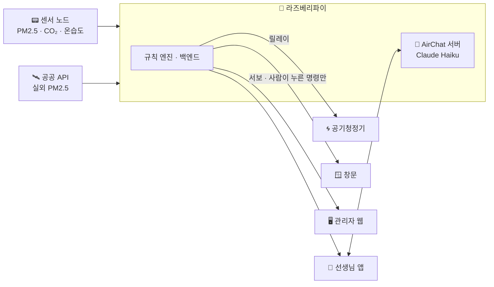

# 🌬️ AirClass — 스마트 교실 공기질 관리 시스템

> 교실 안 공기(PM2.5 · CO₂ · 온습도)와 바깥 미세먼지를 함께 보고
> **공기청정기를 자동으로 제어**하고, **창문 열기·닫기를 추천**해 선생님이 **버튼 한 번으로 실행**하게 하는 IoT 시스템이에요.
> 선생님은 **AirChat**에게 말로 부탁해 예약과 자동화 규칙도 만들 수 있어요. 🏫


> [!NOTE]
> 지금은 **프로토타입** 단계예요. 센서 값은 `shared/dummyData.js`의 더미 데이터이고, 이후 라즈베리파이 백엔드로 교체할 예정이에요.

---

## 🤔 왜 만들었나요?

교실은 CO₂가 금방 오르지만, 바깥 미세먼지가 나쁜 날 무작정 창문을 열면 오히려 공기가 나빠져요.
AirClass는 **실내 값과 실외 값을 함께 판단**해 지금 해야 할 행동을 알려 줘요.

| 상황 | AirClass의 동작 |
|---|---|
| 실내 PM2.5 ≥ 35 | 🌀 공기청정기 자동 ON |
| CO₂ ≥ 1,000 + 바깥 공기 양호 | 🪟 **창문 열기 추천** → 앱에서 원탭 실행 |
| CO₂ ≥ 1,000 + 바깥 공기 나쁨 | 🚫 **창문 닫기 추천** + 공기청정기 가동 |
| 모두 정상 | 😴 절전 대기 |

창문은 **반자동**이에요. 시스템은 추천만 하고, 실제로 여닫는 건 사람이 버튼을 눌러야 해요. (학생 안전 — 손 끼임 방지)

---

## ✨ 주요 기능

**📱 사용자 앱 (담임 선생님)**
- 내 교실 공기질과 실내·외 비교, 상태에 따라 바뀌는 홈 화면
- 창문 열기·닫기 추천과 원탭 실행, 공기청정기 ON/OFF · 자동 모드
- 오늘의 공기 기록, 로그인 · 회원가입

**🤖 AirChat (앱 안의 교실 공기 도우미)**
- "1분 뒤에 청정기 켜줘" → **예약** 제안
- "CO₂ 1,000 넘고 바깥 괜찮으면 창문 열어줘" → **자동화 규칙** 제안
- "청정기 왜 켜졌어?" → 제어 기록을 찾아 설명
- AirChat은 장치를 **직접 움직이지 않아요**. 예약·규칙은 카드로 제안하고, 선생님이 확인해야 등록돼요.
- 서버에 연결되지 않으면 앱 안의 **기본 응답 모드**로 자동 전환돼요.

**🖥️ 관리자 웹 (행정실)**
- 층별 교실 상태 맵, 오늘 실내·실외 PM2.5 추이
- 교실별 모니터링, 장치 일괄 제어, 교실 상세
- 알림 이력(처리 상태 · CSV), 설정(기준값 · 교실 담임), 로그인 · 계정

---

## 🧩 시스템 구성



웹과 앱은 `web/src/api.js`, `app/src/api.js` **한 파일만 거쳐** 데이터를 가져와요. 실제 백엔드로 바꿀 때는 이 파일만 교체하면 돼요.
상태 판정과 창문 추천 로직은 `shared/rules.js` 한 곳에 있고 웹·앱이 같이 써요.

---

## 📁 폴더 구조

```
airclass/
├── shared/    # 웹·앱 공용: 더미 데이터, 상태 판정 · 자동 제어 규칙
├── web/       # 관리자 웹 (React + Vite)
├── app/       # 사용자 앱 (Expo / React Native) + AirChat 화면
├── server/    # AirChat API 서버 (/api/chat → Claude Haiku)
├── deploy/    # 라즈베리파이 배포 (Dockerfile, nginx.conf)
└── docker-compose.yml
```

---

## 🚀 실행 방법

```bash
# 관리자 웹
cd web && npm install && npm run dev      # http://localhost:5173

# 사용자 앱
cd app && npm install && npx expo start   # Expo Go로 QR 스캔
```

## 🍓 라즈베리파이 배포

```bash
git clone https://github.com/chanyoungjoo/IoT-Term-Project.git airclass && cd airclass
cp server/.env.example server/.env        # ANTHROPIC_API_KEY 입력 (깃에 올리지 않기)
docker compose up -d --build              # 웹(/) · 앱(/app/) · AirChat(/api/) 한 번에
sudo tailscale funnel --bg 80             # 공개 주소 연결
```

업데이트할 때는 `git pull && docker compose up -d --build`만 하면 돼요.
`curl -s localhost/api/health`에서 `"keySet":true`가 보이면 AirChat이 연결된 거예요.

> [!WARNING]
> Funnel 주소는 링크를 아는 누구나 접속할 수 있어요. 데모 계정(admin/1234)은 실제 서버 연결 전에 지워야 해요.

---

## 🗺️ 앞으로 할 일

- [ ] 라즈베리파이 백엔드 연결 (`api.js` 교체), 실제 센서 · 공기청정기 · 창문(서보 + 리드 스위치) 연동
- [ ] AirChat 규칙을 실제 규칙 엔진에 등록
- [ ] **지역사회 제안**: ML 실외 미세먼지 예측 · 사전 환기 알림, 공기청정기 풍량 자동 조절, 도서관 · 지역아동센터로 확장
- [ ] 앱 푸시 알림

---

<p align="center">🌬️ <b>AirClass</b> — 우리 교실 공기, 한눈에 보고 바로 행동해요.</p>
