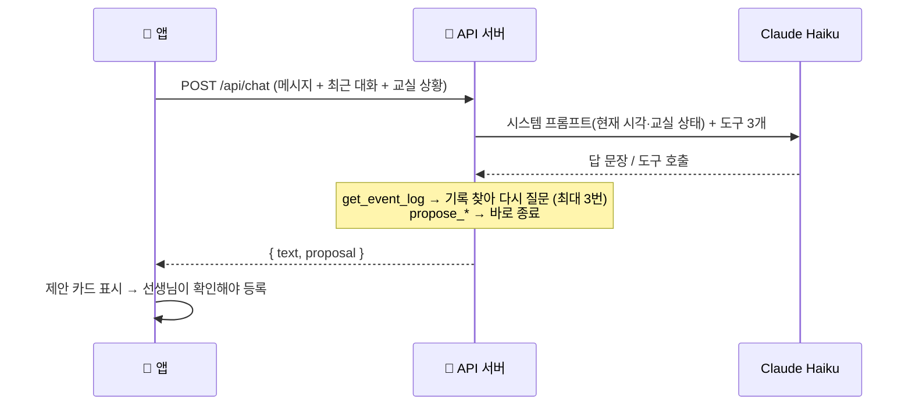

# 🤖 AirClass API 서버 (AirChat)

앱의 **AirChat** 대화를 Claude Haiku에 연결하는 서버예요.
라즈베리파이의 Docker 컨테이너(`api`)에서 돌고, nginx가 `/api/` 요청을 이 서버로 넘겨요.
Node 기본 `http` 모듈만 쓰고, 외부 패키지는 `@anthropic-ai/sdk` 하나예요.

---

## 동작 흐름



## API

### `POST /api/chat`

요청
```json
{
  "message": "CO₂ 1,000 넘고 바깥 괜찮으면 창문 열어줘",
  "history": [{ "role": "user", "text": "..." }, { "role": "assistant", "text": "..." }],
  "context": {
    "roomName": "2학년 2반", "pm25": 18, "co2": 1180,
    "purifierOn": false, "windowOpen": false,
    "timetable": "오늘 5교시(13:40~14:25) 수학 시험",
    "events": [{ "time": "10:12", "device": "purifier", "text": "PM2.5 41로 자동 켜짐" }],
    "schedules": [], "rules": []
  }
}
```

응답
```json
{
  "text": "CO₂가 높고 바깥 공기가 좋을 때 창문을 여는 규칙을 만들까요?",
  "proposal": { "type": "rule", "input": { "name": "...", "when": "...", "device": "window", "action": "open", "exception": "..." } },
  "lookedUpLog": false,
  "usage": { "input": 1234, "output": 120 },
  "model": "claude-haiku-5-5"
}
```

| 상태 코드 | 의미 |
|---|---|
| `400` | 메시지가 비었거나 300자 초과 |
| `429` | 오늘 사용량(`DAILY_LIMIT`) 초과 |
| `502` | Claude 응답 실패 (자세한 원인은 서버 로그에만) |
| `503` | API 키가 설정되지 않음 |

앱은 오류가 나면 **기본 응답 모드**(앱 안의 엔진)로 바꿔서 답해요.

### `GET /api/health`
```json
{ "ok": true, "model": "claude-haiku-5-5", "keySet": true, "today": 12, "dailyLimit": 300 }
```

---

## AirChat 도구

| 도구 | 종류 | 언제 | 입력 |
|---|---|---|---|
| `propose_schedule` | 제안 | "나중에 한 번" (예: 1분 뒤 청정기 켜줘) | `device`, `action`, `delay_seconds` 또는 `at`(HH:MM) |
| `propose_rule` | 제안 | "~할 때마다" 반복 조건 (예: 시험 시간엔 청정기 꺼줘) | `name`, `when`, `device`, `action`, `exception` |
| `get_event_log` | 조회 | "왜 켜졌어?" 같은 질문 | `device` |

**안전 원칙**
- 서버는 장치를 **직접 제어하지 않아요.** `propose_*`는 제안만 돌려주고, 앱에서 선생님이 확인해야 등록돼요.
- 청정기를 끄는 규칙에는 "PM2.5 35 이상이면 다시 켜기" 같은 **안전 예외(`exception`)**가 필수예요.
- 공기 등급(좋음·나쁨)은 LLM이 아니라 **코드가 판단**해 프롬프트에 넣어요. (`shared/rules.js` 기준값 사용)
- 상황에 없는 숫자를 지어내지 않고, 공기질과 관계없는 요청은 거절해요. 답은 한국어 두 문장 이내예요.
- "지금 바로 켜줘"는 도구 없이 "제어 탭에서 바로 할 수 있어요"라고 안내해요.

> `get_event_log`는 지금 앱이 보낸 기록(`context.events`)에서 찾아요. 나중에 실제 DB 조회로 바꿀 자리예요.

---

## 설정 (`server/.env`)

```bash
cp .env.example .env    # .env는 .gitignore에 있어서 깃에 올라가지 않아요
```

| 변수 | 설명 | 기본값 |
|---|---|---|
| `ANTHROPIC_API_KEY` | Claude Console에서 발급한 키 (**절대 커밋 금지**) | — |
| `ANTHROPIC_MODEL` | 사용할 모델 | `claude-haiku-5-5` |
| `DAILY_LIMIT` | 하루 최대 `/api/chat` 호출 수 (한국 자정 초기화) | `300` |
| `PORT` | 서버 포트 | `3000` |

## 실행

```bash
npm install
npm run dev    # 로컬 개발 (.env 읽기 + 파일 바뀌면 자동 재시작)
npm start      # 운영
```

라즈베리파이에서는 루트에서 웹·앱과 함께 띄워요.

```bash
docker compose up -d --build
curl -s localhost/api/health     # "keySet":true 이면 연결 완료
docker compose logs -f api       # 대화마다 [chat] 로그와 토큰 사용량
```

## 비용 · 안정성 안전장치

| 항목 | 값 |
|---|---|
| 메시지 길이 | 300자 |
| 요청 본문 | 32KB |
| 하루 호출 수 | `DAILY_LIMIT` (기본 300) |
| 분당 요청 | nginx에서 20회 제한 |
| 도구 왕복 | 최대 3번 |
| 보내는 대화 기록 | 최근 8개 |
| Claude 응답 대기 | 25초, 재시도 1번 |
| 월 지출 | Claude Console 지출 한도로 관리 |

## 구조

```
src/
├── index.js   # HTTP 서버: 라우팅, 입력 검사, 하루 사용량, 오류 처리
└── chat.js    # 프롬프트 · 도구 정의 · Claude 호출 · 제안 정리
```
